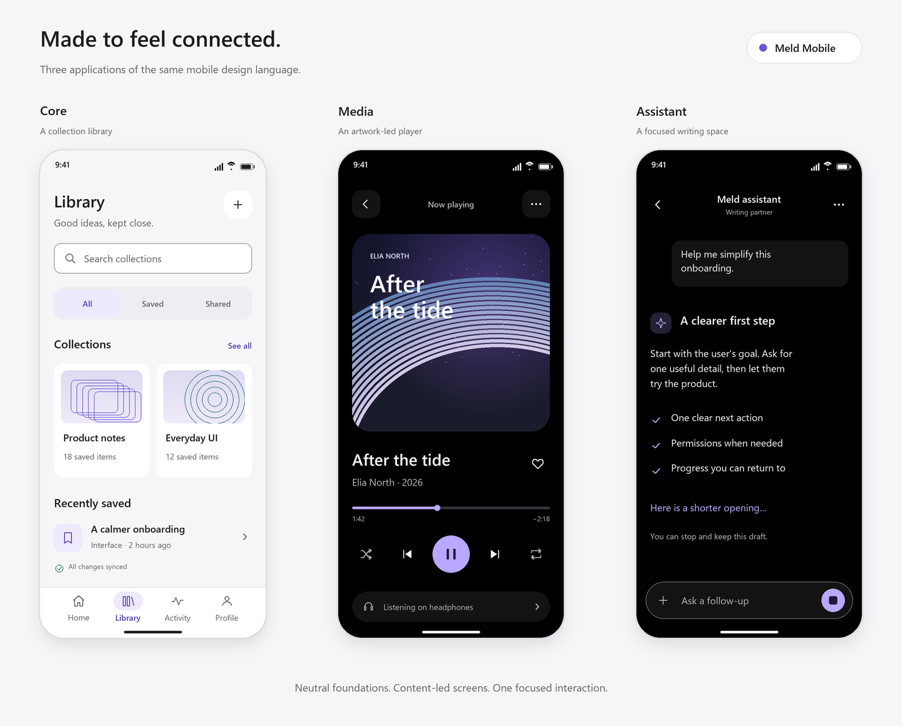
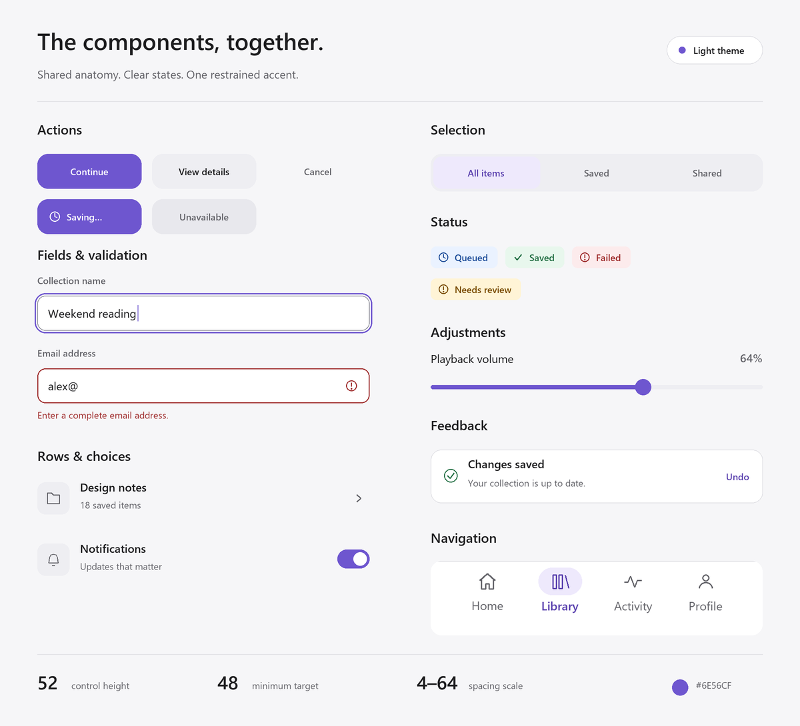
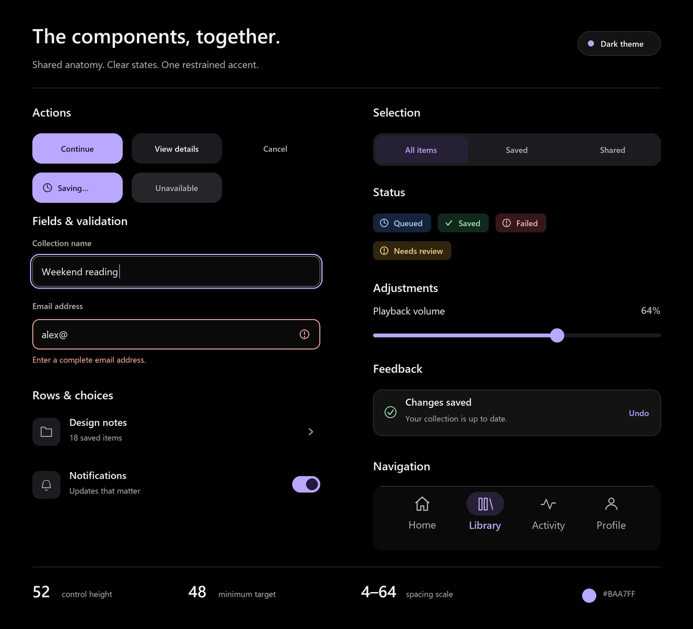
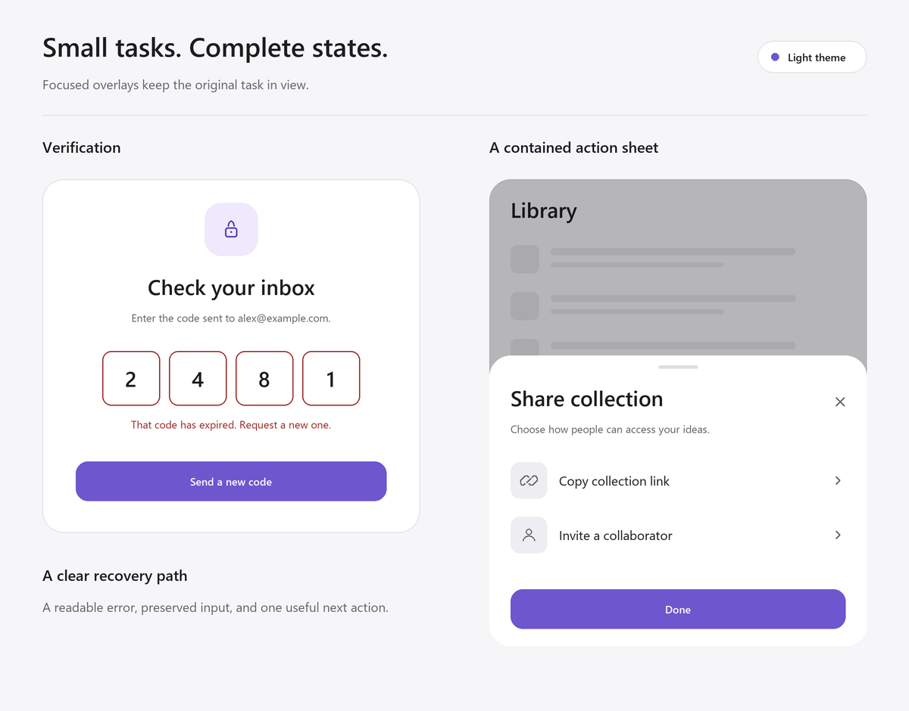
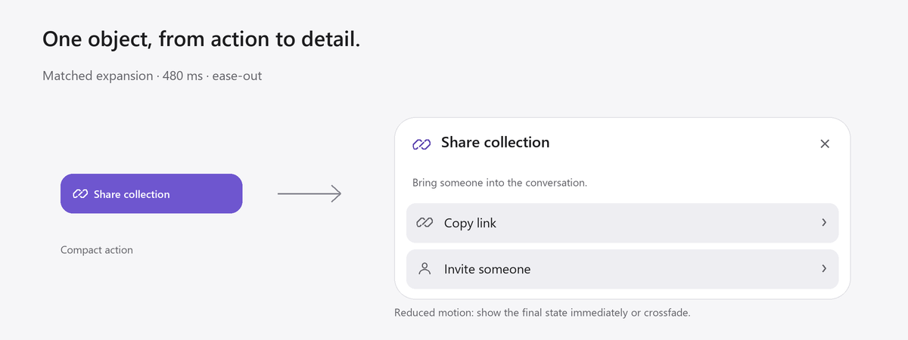
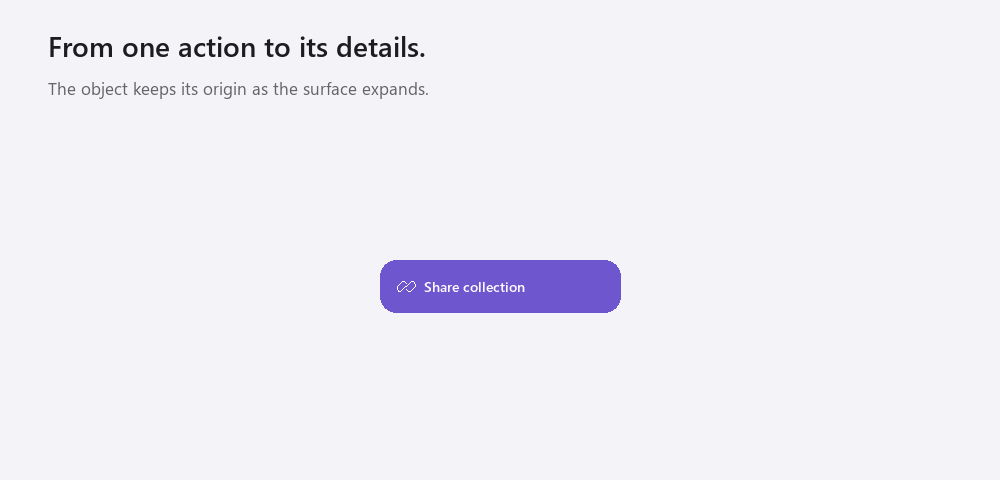

# Meld Mobile

A shared design language for mobile applications: neutral surfaces, native-feeling typography, restrained violet, and interactions that keep their context.

[Design system](MELD_MOBILE_DESIGN_SYSTEM.md) · [Components](#component-examples) · [Forms & overlays](#forms-and-overlays) · [Motion](#motion-example) · [Use in your app](#use-in-your-app)



These original reference illustrations are rendered from the tokens in [MELD_MOBILE_DESIGN_SYSTEM.md](MELD_MOBILE_DESIGN_SYSTEM.md). They show how the same foundations can support different products. The [rendering source](examples/render.py) is included.

## Screen examples

| Profile | Example | What to reuse |
|---|---|---|
| **Core** | [Collection library — full size](assets/screens/library.png) | Clear hierarchy, search, selected filters, content surfaces, grouped rows, and labeled bottom navigation. |
| **Media** | [Music player — full size](assets/screens/player.png) | Content-led artwork, legible metadata, stable transport controls, and a focused accent. |
| **Assistant** | [Writing assistant — full size](assets/screens/assistant.png) | A stable reading column, clear incoming content, and a persistent composer with a stop action. |

Phone examples use 390 × 844 logical-unit artboards and are exported at 2×. Device chrome is presentation context; implementations use runtime safe-area and keyboard insets.

## Component examples

### Light theme

Primary, secondary, quiet, loading, and disabled actions; focused and invalid fields; rows, a switch, segmented selection, status badges, a slider, feedback, and bottom navigation.



### Dark theme

The same anatomy uses the dark semantic palette, raised neutral surfaces, and a lighter violet action color.



| Foundation | Default |
|---|---|
| Primary control | **52** minimum height |
| Interactive target | **48 × 48** minimum |
| Page inset | **24**, or **16** on compact widths |
| Spacing | **4 / 8 / 12 / 16 / 24 / 32 / 40 / 48 / 64** |
| Text roles | **35/40** display, **28/36** title, **20/28** heading, **17/24** body, **14/20** label |
| Action colors | Light **#6E56CF**; dark **#BAA7FF** |

Sizes are logical units. The [specification](MELD_MOBILE_DESIGN_SYSTEM.md#components) defines state behavior, text scaling, accessibility, and platform adaptations beyond these still images.

## Forms and overlays

An expired-code example keeps the entered value and offers a clear recovery action. A contained sharing sheet preserves the original task behind it, with explicit close, labeled choices, and a completion action.



Treat a segmented OTP presentation as **one logical input**. Give sheets native back/dismiss behavior, focus management, scroll handling, and keyboard accommodation.

## Motion example

A compact **Share collection** action expands into its contextual details. The object keeps a recognizable origin as its surface grows.



<details>
<summary>Play the matched-expansion example — animated GIF</summary>



</details>

The transition illustrates the **480 ms signature token** and `cubic-bezier(0.22, 1, 0.36, 1)`. Reading pauses in the GIF are for demonstration. For reduced motion, show the final state immediately or crossfade for at most **120 ms**. The still comparison above is always available.

## Use in your app

1. Copy [MELD_MOBILE_DESIGN_SYSTEM.md](MELD_MOBILE_DESIGN_SYSTEM.md) into your project as `DESIGN_SYSTEM.md`.
2. Choose the **Core**, **Media**, **Assistant**, or **Editorial** profile and the appropriate theme.
3. Implement shared semantic tokens and components, including their loading, empty, error, and recovery states.
4. Add a signature interaction where it improves the task, with reduced-motion and opaque-material fallbacks.

You can give a designer or coding agent this brief:

> Use DESIGN_SYSTEM.md as this app's design source of truth. Follow its semantic tokens, component anatomy, state behavior, screen recipes, accessibility, and platform adaptations. Use the README examples as visual references. Preserve familiar controls and choose one meaningful signature interaction per task area. Deliver the complete flow, including loading, empty, error, large-text, keyboard, and reduced-motion behavior where relevant.

## Rebuild the examples

From the repository root:

```bash
python -m pip install -r examples/requirements.txt
python examples/render.py
```

The renderer reads the specification's JSON token block directly, draws the icons and fictional artwork, and exports the PNGs and GIF in [`assets/`](assets/). It uses installed system fonts; font rendering can vary between machines. No remote images or fonts are needed.

The examples are visual reference illustrations. Native components and their interaction semantics are implemented in the consuming application.

## Sources

Meld is an original consolidated system inspired by [rit3zh's portfolio](https://x.com/rit3zh). The specification includes a [source-linked review of 64 video posts](MELD_MOBILE_DESIGN_SYSTEM.md#evidence-and-coverage), exact source anchors, and the original designers' credits. The example screens use fictional content and original procedural artwork.
